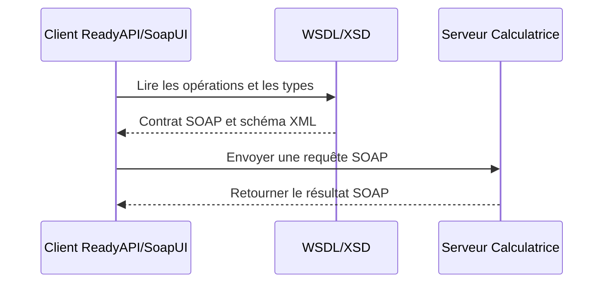

# TP2 – Service Web SOAP de calculatrice

## 1. Présentation

Ce projet met en œuvre une calculatrice exposée comme service Web SOAP en Java. Le service propose quatre opérations : somme, multiplication, soustraction et division. Il est publié avec Jakarta XML Web Services (JAX-WS), configuré avec Maven et testé depuis ReadyAPI/SoapUI.

## 2. Architecture : serveur, client et annuaire

### Serveur SOAP

Le serveur est l’application Java qui contient la logique des opérations. La classe `Calculatrice` implémente le contrat `ICalculatrice`. La classe `ServeurJWS` publie ce service à l’adresse :

```text
http://localhost:8080/calculatrice
```

Le serveur doit rester en cours d’exécution pendant les appels des clients.

### Contrat et WSDL

`ICalculatrice` décrit les opérations disponibles et leurs paramètres. Les annotations Jakarta (`@WebService`, `@WebMethod` et `@WebParam`) exposent ce contrat au format SOAP.

Le WSDL décrit le service : son nom, ses opérations, ses paramètres, ses réponses et son adresse. Il est disponible ici :

```text
http://localhost:8080/calculatrice?wsdl
```

Le schéma XML (XSD) utilisé par le WSDL est disponible ici :

```text
http://localhost:8080/calculatrice?xsd=1
```

Le WSDL et le XSD sont générés à partir des classes et des annotations; ils ne sont pas écrits manuellement dans ce projet.

### Client SOAP

ReadyAPI/SoapUI joue le rôle du client de test. Il lit le WSDL, prépare des requêtes SOAP, les envoie au serveur et affiche les réponses. Le TP demande de tester le service avec SoapUI; une classe Java cliente distincte n’est donc pas nécessaire dans cette version.

### Annuaire de services

Dans une architecture SOA, un annuaire (par exemple UDDI) permettrait de rechercher des services publiés. Cet exercice ne configure pas de véritable annuaire UDDI. Le service est publié directement à une URL locale et le client récupère son contrat depuis le WSDL. Pour ce TP, l’adresse du WSDL sert donc de point de découverte manuel du service, sans remplacer un annuaire UDDI.

## 3. Échange d’une requête



## 4. Structure du projet

```text
SOATP2/
├── pom.xml
├── README.md
└── src/
    └── main/
        └── java/
            ├── service/
            │   ├── ICalculatrice.java
            │   └── Calculatrice.java
            └── serveur/
                └── ServeurJWS.java
```

- `pom.xml` : dépendances et configuration Maven.
- `service/ICalculatrice.java` : contrat du service et opérations SOAP.
- `service/Calculatrice.java` : implémentation des calculs.
- `serveur/ServeurJWS.java` : publication du service avec `Endpoint.publish`.

## 5. Opérations

| Opération | Exemple de paramètres | Résultat attendu |
|---|---:|---:|
| `somme` | 5 et 3 | 8 |
| `multiplication` | 5 et 3 | 15 |
| `soustraction` | 5 et 3 | 2 |
| `division` | 6 et 3 | 2 |

La division par zéro est refusée et produit une erreur SOAP (SOAP Fault).

## 6. Dépendances et prérequis

Le projet utilise Java 17 et Maven. Les dépendances principales du `pom.xml` sont :

- `jakarta.xml.ws-api` : API JAX-WS et publication du point de terminaison.
- `jaxws-rt` : implémentation d’exécution JAX-WS.
- `jakarta.jws-api` : annotations des services et opérations.

IntelliJ IDEA importe ces dépendances à partir du `pom.xml` lors du rechargement Maven.

## 7. Étapes de lancement du serveur

1. Ouvrir `SOATP2` dans IntelliJ IDEA comme projet Maven.
2. Vérifier que le Project SDK et le Module SDK utilisent un JDK 17.
3. Vérifier que Maven a chargé les dépendances du `pom.xml`.
4. Ouvrir `src/main/java/serveur/ServeurJWS.java`.
5. Lancer la méthode `main` avec **Run**.
6. Laisser la fenêtre de lancement ouverte. Le message d’information indiquant que le monitoring n’est pas disponible n’est pas, à lui seul, une erreur. Le programme doit ensuite afficher l’adresse du service et du WSDL.
7. Vérifier dans un navigateur que `http://localhost:8080/calculatrice?wsdl` affiche le document WSDL. Le lien `?xsd=1` doit afficher le schéma XML.

Si le port 8080 est déjà utilisé, la publication peut échouer. Dans ce cas, arrêter l’autre application qui utilise ce port ou choisir un autre port dans `ServeurJWS`, puis utiliser la nouvelle adresse dans ReadyAPI.

## 8. Étapes de test dans ReadyAPI/SoapUI

1. Garder le serveur lancé.
2. Dans ReadyAPI, créer un test à partir d’une définition d’API (WSDL), par exemple **File → New Functional Test → API Definition**. Dans SoapUI Open Source, utiliser **File → New SOAP Project**.
3. Dans l’étape **Specify File**, saisir l’adresse WSDL `http://localhost:8080/calculatrice?wsdl` ou sélectionner le fichier `calculatrice.wsdl` enregistré localement.
4. Si un fichier WSDL local est utilisé, garder le serveur démarré pendant l’importation : le WSDL référence le XSD de l’adresse `http://localhost:8080/calculatrice?xsd=1`.
5. À l’étape **Specify Endpoint**, utiliser l’adresse du service sans le suffixe `?wsdl` : `http://localhost:8080/calculatrice`.
6. Choisir un projet et un test case. Un seul test case suffit pour ce TP.
7. Ouvrir la requête SOAP de l’opération souhaitée. Remplacer les valeurs des paramètres, puis cliquer sur **Submit** ou sur la flèche verte.
8. Lire la réponse dans le panneau **Response**. Par exemple, `somme(5, 3)` doit retourner `8`.
9. Répéter l’essai pour les autres opérations. Pour vérifier la gestion d’erreur, essayer `division(5, 0)` et observer le SOAP Fault.

**Attention :** la fenêtre **Add New Data** sert à ajouter un fichier de données à un test. Ce n’est pas l’écran d’importation WSDL; annuler cette fenêtre si elle apparaît pendant la sélection du WSDL.

## 9. Résultats attendus

Le service accepte une requête SOAP pour chaque opération et renvoie le résultat calculé dans une réponse SOAP. ReadyAPI/SoapUI affiche la requête envoyée et la réponse reçue, ce qui permet de vérifier le fonctionnement du client et du serveur.

## 10. Conclusion

Ce TP illustre les rôles complémentaires du contrat WSDL/XSD, du serveur SOAP Java et du client ReadyAPI/SoapUI. Il montre aussi la différence entre publier un service à une adresse connue et l’enregistrer dans un annuaire SOA : un annuaire UDDI réel n’est pas configuré dans ce projet.
